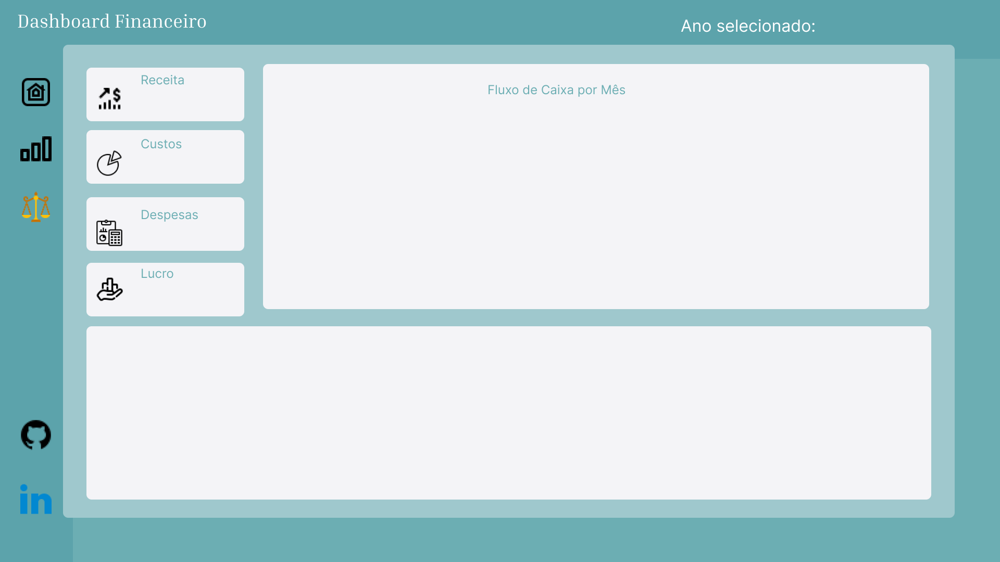
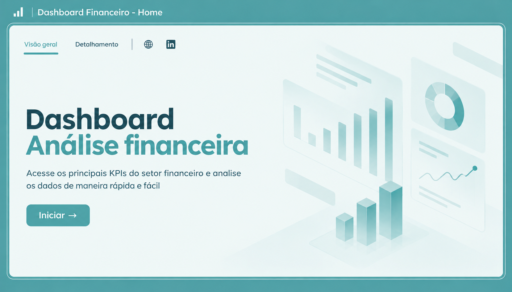

# 📊 Dashboard Financeiro — Fluxo de Caixa

## 📌 Sobre o projeto

Este projeto consiste no desenvolvimento de um dashboard financeiro no Power BI, com o objetivo de organizar dados financeiros e facilitar a análise de receitas, custos, despesas e resultados ao longo do ano.

O dashboard permite acompanhar indicadores financeiros, analisar variações mensais e visualizar informações por tipo de conta e cliente.

## 🎯 Objetivos

- Acompanhar receitas, custos, despesas e lucro.
- Analisar o desempenho financeiro mensal.
- Identificar variações nos resultados.
- Facilitar a visualização e interpretação dos dados financeiros.

## 🛠️ Ferramentas utilizadas

- **Power BI Desktop:** criação do dashboard e das visualizações.
- **Power Query:** extração, transformação e tratamento dos dados (ETL).
- **DAX:** criação de medidas e indicadores financeiros.
- **Figma:** planejamento e desenvolvimento da identidade visual do projeto.

## ⚙️ Etapas do desenvolvimento

1. Organização dos arquivos e das fontes de dados.
2. Extração, transformação e tratamento dos dados no Power Query.
3. Organização das tabelas e criação dos relacionamentos no modelo de dados.
4. Criação de medidas e indicadores financeiros com DAX.
5. Desenvolvimento das páginas, gráficos e elementos visuais do dashboard.

## 📈 Principais funcionalidades

- Indicadores de receitas, custos, despesas e lucro.
- Análise de receitas por mês.
- Visualização de pagamentos por tipo e período.
- Análise de receitas por tipo de conta e cliente.
- Detalhamento dos resultados financeiros mensais.

## 🖥️ Visualização do projeto

### Visão geral do dashboard

### Dashboard financeiro — segunda tela

### Dashboard financeiro — terceira tela

## 📚 Aprendizados

Este projeto faz parte do meu desenvolvimento prático na área de Análise de Dados, permitindo aplicar conhecimentos de ETL, transformação de dados, modelagem, DAX e visualização de informações.

## 👨‍💻 Autor

**Adamans M. M. Souza**

- [GitHub](https://github.com/adamanssouza)
- [LinkedIn](https://www.linkedin.com/in/adamans-m-4b15b9227)

---

*Projeto desenvolvido para fins de estudo e portfólio profissional.*